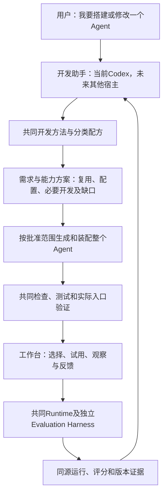

# Agent开发工具：产品需求

用途：新建/修改能力时确定应有行为、范围、约束与验收依据。本文拥有完整P01—P22和16类对象要求；实际实现查源码，执行和批准状态查[当前工作](当前工作.md)。术语见[术语](术语.md)，分类方法见[开发方法](开发方法.md)。

## 产品定位

研究对象是**帮助用户搭建、配置、验证、使用和持续修改不同 Agent 的开发工具**。当前由 Codex 执行开发方法，框架提供共同运行底座，工作台供用户试用与观察；未来其他开发助手也应能沿用共同方法与业务产物。

它不是某个销售分析 Agent，也不是“生成业务 Skill 文件”的工具。用户不用先列全所有技术组件，更不用现在为未来业务 Agent 决定具体审批、记忆或代码执行政策。开发工具应具备识别这些问题、提出方案并按批准结果生成和配置的能力。

“完整”在本文指覆盖需求、设计、生成、装配、验证、交付、使用、修改及生命周期的审查地图；不是宣称存在适用于一切业务的穷尽清单，也不是要求第一版实现所有高级能力。新场景出现时仍要主动检查遗漏。


## 产品关系



图表示目标职责，不代表全链已接通。开发助手管理产物，业务 Agent 在 Runtime 中使用产物；网页不另写一套 Agent Loop 或评分器。开发端可迁移与业务运行模型可更换是两件事。

## 2. 完整产品地图：22 项开发工具能力

下表为用户已认可的开发工具产品范围。**每次搭建要判断适用性，只有适用的能力才实现/启用；具体技术方案与实施分期另行确认。** “工具要具备的能力”与“某个 Agent 是否启用该组成”分开。

### A. 需求理解与方案形成

| ID / 工具能力 | 工具必须能处理的问题 | 应交付什么 | 如何核对 |
|---|---|---|---|
| P01 需求澄清与已有决定继承 | 用户想解决什么、谁使用、输入/产出/失败代价；哪些已经说清 | 可追溯的业务契约、例子、基线与未决项 | 不让用户重复原spec；真实例子与验收对应，不把组件名当业务目标 |
| P02 判断是否需要 Agent | 用确定性程序、单次模型、固定Workflow还是动态Agent更合适 | 简单替代方案、动态决策的必要性、质量/资源取舍 | 解释为什么需要模型决定下一步；能用计算工具的部分不强迫LLM计算 |
| P03 能力拆解与主动补全 | 完成任务需要什么组成、缺少什么隐含依赖 | 按任务组合的能力方案与依赖关系、需要/不需要的理由 | 用户没列全也能发现缺口；必要项未接通不能从交付中消失 |
| P04 资产盘点与复用发现 | 已有Agent/Tool/Skill/知识/数据/配置是否能复用，证据是否有效 | 有来源/版本/适用范围的可复用资产与差距 | 已存在不等于可用；只检查获准范围，不扫描无关私人文件 |
| P05 研究、选型与可行性 | 配置已有组件、薄适配还是新增代码；是否满足本机/许可/成本条件 | 官方事实、替代方案、关键路径验证、维护责任及限制 | 最新文档不冒充本地兼容；免费API不等于开源许可；未测资源与成本标Unknown |
| P06 架构与执行方案 | 组件如何组合，谁提供输入/消费输出，状态归谁，怎样失败/停止 | 接口与职责、执行流程、依赖/控制边界、批准范围 | 必要依赖有去向；不为每个Agent复制运行Loop；重大取舍先review再实现 |


### B. 标准化开发、生成与装配

| ID / 工具能力 | 工具必须能处理的问题 | 应交付什么 | 如何核对 |
|---|---|---|---|
| P07 分类开发与生成配方 | 不同类型产物怎样创建、复用和修改；何时需要写代码 | Agent、Tool、Skill、Workflow、知识、Memory等各自固定的方法与版本 | 同类产物用相同方法；业务内容不同；记录真实方法调用，不靠自填“已使用” |
| P08 跨组件契约与标准 | 字段语义、输入输出、错误、依赖、权限、版本怎样表达 | 分类产物合同、受支持能力、独立验证案例 | 工具参数、返回、调用流程和消费者一致；统一不意味着所有产物同一种格式 |
| P09 配置装配与绑定 | 如何把生成物真正接到同一Agent/Runtime/工作台 | 模型/指令、工具注册、知识/Skill/Memory/子Agent引用、控制与评测绑定 | 用户不手工接线；无效引用、未支持能力、缺依赖明确阻断；配置不授予额外权限 |
| P10 运行环境与资源准备 | 路径、依赖、连接、凭据引用、工作目录、启动/停止归谁管理 | 依赖/环境约定、启动/预检/关闭方法、资源身份与缺项提示 | 缺项可诊断；不凭空假设已有服务；不在普通产物写入密钥，不清理别人的进程 |
| P11 生成过程与异常管理 | 开发工具自己生成到一半失败、取消或重复执行怎么办 | 当前步骤、已完成/未完成、失败位置、产物差异及恢复方式 | 不覆盖已有Agent，不把半成品标就绪；重做前识别已有工作；不会无限重试或静默扩大改动 |


### C. 验证、试用与可诊断交付

| ID / 工具能力 | 工具必须能处理的问题 | 应交付什么 | 如何核对 |
|---|---|---|---|
| P12 共同预检与接入检查 | 格式、引用、依赖、接口与运行组件是否兼容 | CLI/工作台同源逐项状态和明确阻断 | 文件存在、函数名存在、SDK可加载、实际调用成功分别取证；页面不另藏规则 |
| P13 工程测试与真实验证 | 新增/修改是否符合契约，实际入口能否完成任务 | 已确认公共边界上的TDD红绿、适用组件/集成/端到端证据 | 不为每个内部函数造测试；环境错误不是行为red；Mock不能替代真实模型/工具运行 |
| P14 评测设计与可信评分 | 怎样检验答案/过程/副作用；评分器本身是否误判 | 案例集、独立期望、Rubric、适用确定性检查、人评/模型评分及校准 | 工具请求≠执行成功；关键词≠正确；开发/保留集与反例按风险选择，不能自评当验收 |
| P15 工作台交付与使用体验 | 用户怎样发现、选择、输入/继续、观察步骤、停止、评测和反馈 | 同一配置/Runtime的可重复入口、可理解状态与版本 | 生成物能被共同入口消费；待确认/失败/取消不装成完成；技术ID由系统关联 |
| P16 记录与诊断接口 | 用户与开发助手怎样看到同一次运行、定位失败与瓶颈 | Trace、工具请求/结果、实际上下文、错误分类、延迟/资源及相关版本 | 日志可关联且缺失明示；不事后补写模型未返回的内部思考，不把猜测当根因 |


### D. 修改、复用与持续管理

| ID / 工具能力 | 工具必须能处理的问题 | 应交付什么 | 如何核对 |
|---|---|---|---|
| P17 修改及依赖影响分析 | 改工具、流程、Prompt、知识、Memory等时哪些资产受影响 | 明确差异、消费者/配置/案例影响、必要迁移与重验 | 按原资产增量修改，不用重建替代修改；未受影响Agent保留；旧通过不用于新版本 |
| P18 完整版本与启停管理 | 本次实际使用哪组模型/指令/代码/数据/环境/评分标准 | 有身份的候选/已接受/启用版本、依赖、兼容与回退方式 | 代码hash不能代替数据/模型身份；可追溯不承诺随机输出逐字复现；停用和删除分开 |
| P19 反馈、诊断与迭代 | 用户说“不对”后如何定位并改进对应部分 | 反馈关联、正确要求、改进方案、获批修改与前后回归 | 不把错误输出存成期望；不自动把反馈升级成全局规则或Memory；效果按实际样本说明 |
| P20 开发宿主可迁移 | 以后换开发助手怎样继续生成和维护，而非重造业务资产 | 宿主无关方法/标准命令/产物合同与必要宿主映射 | 不依赖专有工具名才可解释方法；目标宿主分别实测；Claude/Grok具体接入当前Unknown |
| P21 项目与资产治理 | 业务资产、共享底座、生成器、运行环境和密钥分别由谁负责 | 归属/共享范围、依赖来源、权限、升级与清理规则 | 生成器不会把自己开发权限传给业务Agent；外部资料不升级为开发指令；共享资产改动影响可见 |
| P22 发布与持续运营路线 | 本机启用、多人使用、远程服务分别还需什么 | 当前启动/停止/回退；按需发布门槛、监控、容量、负责人/故障手册和退出计划 | 本机先核对实际启用版本及故障；生产阶段再验证灰度/回退/SLO、配额、隐私与资产退役；不偷带首批实施 |


## 3. 开发工具要管理哪些Agent组成

第2节回答“开发工具会做什么”；本节回答“它开发/配置的对象有哪些”。不能只列对象，漏掉开发方法、装配与生命周期。

| 对象 | 何时需要／主要选择 | 工具要能生成、复用或配置的内容 | 最低可观察结果例子 |
|---|---|---|---|
| 模型与模态 | 使用模型时；语言、视觉/音频、工具调用、结构输出、上下文和资源按任务选择 | 能力要求、Provider/模型声明、参数及适用fallback | 模型实际完成所需能力；接口可连不等于工具调用正确 |
| Prompt/指令与输入输出 | 有任务输入与结果就要明确；结构化格式按消费者决定 | 任务、边界、来源优先级、示例、完成/停止、字段/单位/缺值/错误约定 | 缺字段不进入下一步骤；格式正确与事实正确分开检查 |
| Tool与确定性服务 | 精确计算、读取外部数据、执行动作时 | 参数/返回/错误、注册、依赖、允许范围、读写副作用 | 查到正确对象并核对真实结果；不能只检查请求工具名 |
| MCP等连接器 | 外部工具/资源需要协议接入时；本地函数不必服务化 | 协议/能力兼容、连接和认证引用、工具选择、启动/关闭与错误处理 | 列出工具与真正调用分别验证；本地与远程版本分别核对 |
| 业务Skill及资源 | 有可复用任务方法时；不是每个Agent必有 | 适用条件、步骤、资源、依赖、按需加载与更新 | 真正启用并消费相关内容；文件规范不等于Runtime支持 |
| Workflow、路由与规划 | 任务有固定次序、条件分支或需动态下一步时 | 节点/输入输出、分支/汇合、计划/重规划、停止与失败规则 | 不满足条件不进入下一步；分支失败/部分完成有明确结果 |
| 数据、知识/RAG | 依赖文档或数据源时；不强制向量库 | 权威来源、解析/清洗、索引/检索、引用、更新/删除、数据粒度/关联/质量 | 找到正确版本与证据；无答案、过期/冲突资料按约定处理 |
| 领域语义/Ontology | 多来源实体、指标口径和关系需要统一时 | 实体/标识、口径、关系、约束和来源映射 | 不把“用户数”和“订单数”混算；Ontology不是必须先建图数据库 |
| Context与任务State | 每次模型调用的上下文需要受控；多步骤/多轮时需状态 | 输入选择、摘要/截断、状态字段/更新者、会话身份和作用域 | 用户能核对实际传入内容；任务之间不串线，关键约束不因压缩失效 |
| 长期Memory | 跨会话确有保留价值且得到允许时 | 保存对象、读写触发、来源/更新时间、修改/删除和作用域 | 错误记忆可更正，删除后不继续误用；不把所有对话自动当事实 |
| 子Agent与协作 | 独立任务分工/隔离收益超过复杂度时 | 委派输入输出、权限/上下文、并发/总预算、合并/冲突/失败/交接规则 | 子任务失败可见，合并结论可追溯；不能以数量多证明效果更好 |
| 动态代码与计算环境 | 预注册工具不足、任务需要临时计算时的可选能力 | 允许语言/依赖、文件/网络/进程范围、限时限额、产物导出与清理 | 能取回代码和结果；越界访问/无限循环受阻；虚拟环境不等于沙箱 |
| 执行控制与可靠性 | 有循环、外部调用、等待或写操作时按需细化 | 总预算、timeout、取消、重试/退避、幂等核对、并发合并、checkpoint/恢复 | 停止后不启动新步骤；操作结果不明先核实；内存历史不冒充跨进程恢复 |
| 人工交互与权限 | 需要澄清、审批或人工接管时；具体政策搭建时确定 | 等待/批准/拒绝/取消、回应归属、批准内容/版本、受控资源和凭据引用 | A的回应不能继续B；批准后参数变更需按政策重验；无回应不当批准 |
| 安全、隐私与资产保留 | 有外部内容、敏感数据、工具/代码时按边界选择 | 指令/数据信任边界、最小权限、输入/下游输出校验、记录/保留/删除规则 | 网页“忽略规则”不改变工具权限；Trace不因方便而记录未授权私人数据 |
| 测试、Rubric与运行观测 | 所有交付都有适用检查；业务评分按任务选择 | 正常/失败/边界/对抗/回归案例、独立期望、评分器、Trace/指标绑定 | 过程/结果/副作用分别有证据；评分器误判有校准；缺证据标Unknown |


## 分类标准化要求

所有部分标准化意味着一条共同开发流程、每类对象适用的方法/产物合同及同源接入与检查语义。业务内容和格式按真实消费者选择；不能把一份需求文档当作新自研DSL、万能插件平台或已生效Schema。每类配方的十项完整合同由[开发方法](开发方法.md#每类配方必须表达的合同)唯一维护。

## 共同接入与验证要求

```text
生成/修改产物
 → 共同定义能解析（格式/引用明确）
 → 运行消费者确实支持（接口/依赖/能力匹配）
 → 实际入口运行（工具/流程/状态与结果核对）
 → 任务质量验证（独立标准）
 → 用户接受
```

CLI、工作台与后续Harness应复用同一解析/注册/Runtime，不分别解释业务资产。任一必要环节缺失，就报告具体缺口；不能因为有一个检查器就称“保证直接可用”。生成过程遵循方法的证据与产物合规证据也分开：填写standard_version不能证明实际按方法开发。

框架已有能力优先配置；缺失且必要的部分由工具提出接入/开发方案，经适用批准再实施，而不是把缺口留给用户手写或悄悄忽略。新的自研接线须有公开接口限制或实际需求依据。

## 开发助手迁移要求

共同方法应让具备项目读写/命令执行能力的开发助手理解并执行；原生Skill发现方式、命令调用/权限等由宿主入口映射。共享产物通过共同检查，不以不同宿主是否说“我完成了”为准。当前只使用Codex，Claude/Grok具体开发产品能力尚未确定/实测，不承诺原样自动加载同一目录。需要第二宿主时再验证同一输入、产物和检查结果。

Agent Skills文件格式可以作为开发Skill/业务Skill各自接入的研究输入；两者消费者不同，仍要分别验证。支持文件格式不代表脚本可运行、工具已授权或上下文语义相同。

## 使用例子

以下都是解释性案例，不是实际生成/运行成功证据，也不是要求用户现在选其中一个产品。

### 例一：用户要求“帮我搭建一个数据分析Agent”

开发工具先问清要分析什么、输入表有哪些字段、指标口径/成功结果与资源要求；核对现有数据/工具/模型能力，然后给出整个组合方案。它可能复用确定性汇总工具、新增某个计算服务、生成分析指令/可选业务Skill、配置工具注册和数据引用、安排需要的分析步骤、准备数值与证据不足案例、绑定评分与Trace、交付同一工作台入口。

是否需要RAG、Memory、子Agent或临时Python由该任务决定。需要时工具知道应研究/配置/开发和验证什么；不需要时给出理由。这里要设计的是工具的分析/生成能力，不是现在让用户决定这个虚构Agent是否发邮件、默认能否执行代码。

以后用户说“新增按城市比较”，工具应识别数据/口径、计算工具、Prompt/Workflow、输出/图表与案例的受影响部分，按获批范围增量修改、重验并更新版本，不重新搭一套Agent。

### 例二：用户要求“帮我搭建一个知识问答Agent”

同一开发方法先检查资料来源、更新日期、可回答范围与引用/无答案要求；选合适的检索方式，必要时配置文档处理/检索接入，生成问答指令、引用结构、工具和资料绑定，准备正确资料/缺资料/冲突版本案例、评分与运行记录，交付同一工作台。

它与数据分析Agent的业务代码和知识管线不同，但需求→组合方案→分类生成→配置装配→验证→工作台→修改的过程相同。不能只用“两个不同SKILL.md”证明整个开发工具可复用。

## 按场景适用的原则

### 6.1 每个Agent都应作的开发判断

目标/价值基线、输入输出、执行方式、数据/工具来源、适用能力组合、权限/失败/预算、验证与证据、版本/依赖、运行入口及维护归属。这里“必做”是作适用判断和给出交付依据，不意味着每次跑几十个测试或造几十份文档。

### 6.2 按场景实现的组成

RAG、Ontology、长期Memory、Subagent/A2A、动态代码/沙箱、持久恢复、远程MCP、复杂Workflow、多模态等。开发方法应能识别和处理这些需求；本轮不把所有运行能力一次建齐。对选定任务必要而未接通的部分，不能因属于可选类就说任务已完成。

### 6.3 后续生产/多人阶段的扩展

认证/租户隔离、发布灰度/回退、服务SLO和告警、容量/队列/配额、备份与恢复、数据保留/删除、供应链升级/退出、运营负责人。这些需要出现在完整地图，但当前本地学习与开发阶段只做适用设计/路线；远程部署、CI和定时属于后续条件范围，未因本轮范围认可而获得实施授权。

## 费用、证据、数据与变更约束

这些约束定义应有行为，不表示已有实现。

- **费用与复用：** 本地优先，不新增付费API、云服务、订阅、绑卡或付费试用。优先成熟、主流、免费开源组件；实际采用软件应为OSI认可开源许可证，或官方明确允许自由使用/修改/分发的公共领域代码（如SQLite）。通用运行/评测/记录能力优先复用，项目拥有业务规则、分类合同和必要接线。
- **完整使用闭环：** 产品需支持搭建→试跑→观察/评测→人工review→开发助手诊断→调整/扩展→回归。核心交互、过程/评分摘要、反馈与回归操作在同一试跑页衔接，详细记录可链接；允许明确聊天指令，系统自动关联对象，不要求用户手填技术ID。页面不拥有评分逻辑，被测Agent不决定自己是否通过。
- **评价与证据：** 每个Agent定义适用正确性/完成率、证据支持、耗时、token/成本取舍；没有统一绝对性能门槛。批评测一次发起后自动完成各例、适用评分和报告，也支持只给旧结果新增评分；业务调用和评分分别计量，空案例、工具失败、评分错误和保存未知分别报告。输入/数据/标准及相关版本固定，无法测量标Unknown。
- **实施阶段与授权：** 具体阶段、暂停事项与批准范围由[当前工作](当前工作.md)唯一维护；产品范围确认不代替组件选型、架构批准、实施授权或用户接受。
- **数据边界：** 项目自带合成工单/示例手册允许按已确认范围完整记录，本次不新增日志详情开关。该许可不覆盖真实客户数据、无关私人资料或密钥；接入前另定权限/记录/保留规则。未经验证不承诺自动辨识真假数据或自动脱敏。
- **验证素材与复用：** 不要求用户先选正式业务Agent才能开发通用工具；现有教学Agent只是技术素材。已接受的有限P1结果和目录页技术证据保留，可按适用层复用，不重跑来制造进度，也不据此声称完整产品或真实模型链已通过。
- **工程顺序：** 先目标与例子→研究/可行性→确认取舍和架构→TDD公共行为/验收边界→派生实施规格→任务拆解review→获准实施。实现时逐行为red→green，实际入口验证、清理、固定候选独立Standards/Spec审查及用户验收分别完成；已确认决定不重复询问。派生规格不是第二份Source of Truth。
- **变更边界：** 接口、架构、技术或范围有重大变化，先给证据、影响和最小方案再获适用批准。用中文解释实际架构/代码、数据变化、失败行为、取舍及证据；反馈和研究建议不自动修改全局规则、Skills、Memory或权限。
