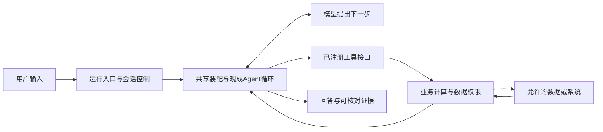

# 理解架构与定位改动

用途：解释“为什么这样分层”以及“新任务从哪条调用关系查起”。字段、默认值、函数签名、依赖版本和完整文件树直接读代码，不在本文镜像维护。词义统一见[术语](术语.md)，当前实现缺口见[当前工作](当前工作.md)。

## 目录职责与读取时机

目录说明应帮助读者决定去哪里、什么内容应放在那里。实际文件清单和实现行为以目录及消费者为准，不在这里维护全量目录树。项目工程归属约束由[项目指令](../../AGENTS.md#ownership--architecture)维护；下表用于定位，不能仅凭目录存在判断能力已接通。

工作区的`agent-foundation/`是应用项目；同级`review/`保存开发助手流程、文档治理、Git筛选等工作的候选、检查与原始证据。两者区分应用本身与开发过程；治理试验的状态不代替应用开发状态。工作区`.git/`是Git管理提交、分支和暂存的内部目录，通过Git命令查看，不作为手工编辑的项目资料。

以下路径相对于应用目录：

| 目录 | 去这里解决什么问题 | 读取与写入边界 |
|---|---|---|
| `foundation/` | 查多个业务Agent怎样共用配置读取、模型装配、执行与检查 | 改共享机制时读取；实际调用关系见下文代码导航，不因一个业务需求直接扩展共享层 |
| `agents/` | 找某个业务Agent自己的配置、指令、工具、服务和案例 | 新建或修改具体Agent先读对应子目录；它不是Codex自身的Skill目录 |
| `agents/_template/` | 查生成新Agent时复制哪些基础资产 | 修改生成合同或模板时读取；[scaffold源码](../../foundation/scaffold.py)定义实际复制及失败行为，复制完成不等于业务内容完成 |
| `agents/knowledge_helper/` | 查资料问答示例的任务、资料与检索实现 | 修改该示例或复用其检索方式时读取；答案依据从其原始资料核对 |
| `agents/support_insights/` | 查工单分析示例的计算、工具和本地草稿实现 | 修改该业务或分析其实际副作用时读取；示例不表示已接入真实客服/Jira系统 |
| `.agents/skills/` | 查Codex执行项目开发或验证任务时的方法 | 是开发助手读取的流程资产；与业务Agent运行时的能力分开。可见目录不等于当前会话已发现或使用对应Skill |
| `docs/current/` | 读当前需求、任务、验收、决定及操作正文 | 按主索引选择相关主题；新信息先整合进已有所有者，不为每轮会话再建一套文档 |
| `tests/` | 查代码行为的预期、边界和回归用例 | 修改实现时读取相关用例；测试源码只说明检查设计，实际是否通过另查该次执行证据 |
| `history/` | 追溯旧批准、决定、失败或恢复基线 | 平时不从这里重建需求；原件随Git提供的范围由[历史入口](../../history/README.md)说明 |
| `evidence/` | 查本项目保留的原始读取会话及相应输出 | 是执行证据，不能当作当前规则或规格；使用前核对对象、输入、版本和检查范围 |
| `features/` | 查旧功能尝试和仍保留在原位置的证据 | 是遗留容器，现行要求从主索引定位；不因旧目录存在继续套用固定spec/design/results文件组合 |
| `.scratch/` | 追查旧工作台实验、环境及过程产物 | 按具体恢复/诊断需要读取；实际重放先核对[操作前提](使用与排错.md#历史实验重放前提)，获准范围看当前任务 |
| `.venv-catalog/` | 使用本机已有的目录页开发/检查Python环境 | 是可重建的本机依赖环境，不是源码或文档；不入Git。缺失时按[使用与排错](使用与排错.md)处理环境前提 |

业务Agent内部的可选目录也要按消费者理解：`data/`保存该业务实际使用的数据/资料；`knowledge/`、`skills/`、`workflows/`是模板预留的知识、业务方法和工作流位置。它们的具体使用约定分别由[模板资料说明](../../agents/_template/data/README.md)、[知识说明](../../agents/_template/knowledge/README.md)、[业务Skill说明](../../agents/_template/skills/README.md)、[工作流说明](../../agents/_template/workflows/README.md)维护。判断是否真正加载，应读[配置消费者](../../foundation/config.py)、[装配入口](../../foundation/builder.py)及业务服务，不从文件夹名字推断。

“为什么分开、改动归谁、什么时候读取”需要文档表达；“当前有哪些文件、字段默认值、运行时到底加载了什么”通过目录、代码和实际检查取得。新增目录只有在形成新的职责或读取场景时才更新本节，不为每个新增文件同步一份树状清单。

## 一次业务请求怎样分工

这张图表达职责边界，不是本轮模型运行证据。模型选择工具与参数；运行时调度；工具接口转交；业务层负责真实求值、校验和不可绕过的业务规则；模型组织最终答复。审批、失败与实际工具结果需要单独验证。

以support_insights为例：问最近投诉，先到确定性服务核对计数和案例，再到工具接口看怎样暴露能力，最后读装配和运行入口理解调用/审批。只看Prompt无法判断计算是否正确，也不能证明写操作被真正限制。

## 按问题找代码

| 要回答的问题 | 先到哪里找；为什么 |
|---|---|
| 指标如何计算、资料如何查、草稿写到哪里 | [support服务](../../agents/support_insights/services.py)、[knowledge服务](../../agents/knowledge_helper/services.py)：从实际求值与数据消费者开始 |
| 模型可以调用什么，参数和错误怎样传递 | 相应Agent的tools.py及agent.yaml；使用实际接口和注册来源，不维护手抄工具清单 |
| 配置如何读取、哪些规则在运行时生效 | [config.py](../../foundation/config.py)及调用者；再和[catalog.py](../../foundation/catalog.py)比较静态检查边界 |
| 模型、工具、预算、审批、检查点怎样装配 | [builder.py](../../foundation/builder.py)；相关Provider入口在[models.py](../../foundation/models.py) |
| 会话、批准/拒绝、输出如何处理 | [runner.py](../../foundation/runner.py)、[CLI](../../foundation/cli.py)，再看相关公共边界测试 |
| 新建、失败和已有目标如何处理 | [scaffold.py](../../foundation/scaffold.py)、[测试](../../tests/test_scaffold.py)；验收预期由[第1步验收](第1步验收.md)定义 |
| 页面与CLI是否读同一结果、怎样重载 | [catalog.py](../../foundation/catalog.py)、[web.py](../../foundation/web.py)及其实际调用者 |
| 评测到底判断了什么 | [evaluation.py](../../foundation/evaluation.py)和实际eval_cases.json；判断方法见[验证与安全](验证与安全.md) |

## 新需求落在哪一层

- 只对某业务成立：先修改该Agent的资料、指令、服务、工具、配置与独立案例。例如“按渠道比较”先核对渠道数据/口径、计算输出和引用，不能只加一句Prompt。
- 多个Agent共同需要：先确认共同需求与旧行为，再核对当前公开库能否配置/适配；确有缺口才扩展foundation的小接口。新天气查询或合同操作先从业务工具/服务开始，不为单个业务扩展全局运行循环。
- 需要确定性顺序或明确分支：业务数据校验、计算、条件判断交给可检查步骤；只有下一步确需动态选择时才让模型决定。复杂图流程、长期记忆、MCP、RAG、子Agent等按真实任务设计，不因名字高级就提前接入。
- 需要新的界面、观测或评分：它们分别承担交互、记录和评价职责，不能把第二套Loop或评分逻辑藏进页面。组件采用须回到研究和架构门槛，不沿用历史推荐排序。

改变共享底座前列输入输出、失败行为、消费者、兼容与迁移影响；修改公开产物约定时同步模板、示例和相关测试。用未受影响Agent的适用回归检查保留行为，不以哈希未变替代正确性。

## 学习顺序与练习

先读service→tool→真实配置→builder→runner→evaluation，理解数据求值、模型选择和执行控制分别归谁，再研究复杂组件。

在隔离副本上可做三类练习：改变合成工单分类并观察独立期望能否发现；移除一个工具引用并解释配置与实际执行各检查什么；比较写草稿批准/拒绝的副作用。先提出预期，再实际观察。运行模型、修改示例数据或创建目标仍须处于获准任务范围。

如果要做销售额教学例子，可设计十进制、负数和规模上限等业务边界，再用独立计算期望核对；具体实现从现有服务/工具范式开始，不把文档示例当已实现产物。生产、跨进程持久化和多租户要求按[产品地图](产品需求.md)与实际任务评估，教学理解不构成生产交付。
